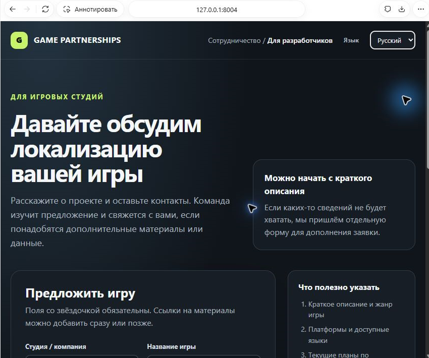
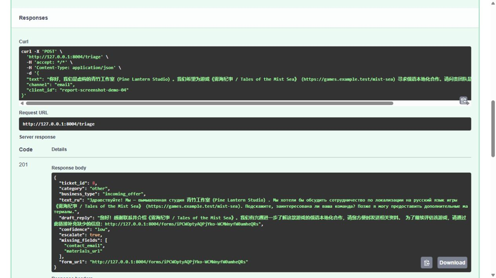
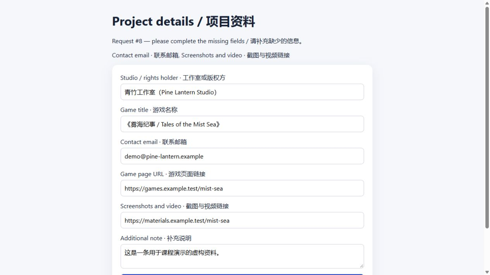
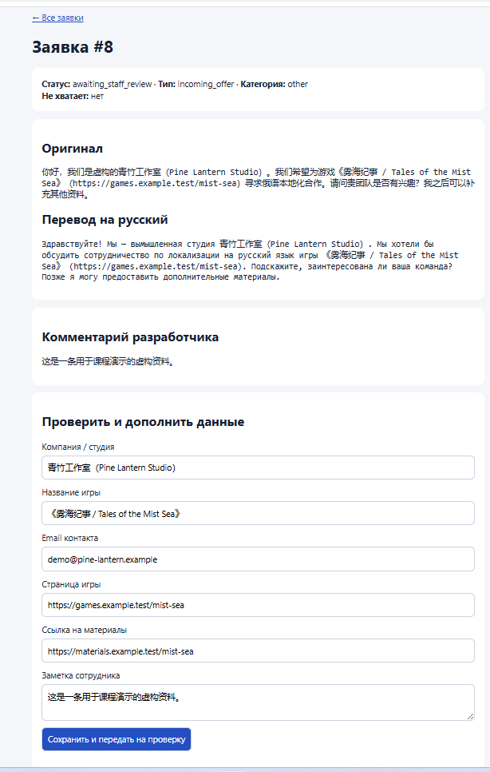

# Отчёт по практике VPk04.1

> Отчёт по учебному MVP. Для демонстрации используются вымышленные данные. Скриншоты пользовательской страницы, API и обработки заявки встроены в раздел 6. Для сдачи дополнительно запишите два ролика по сценарию из [VIDEO_GUIDE.md](VIDEO_GUIDE.md): демонстрацию на 2–3 минуты и защиту на 5–7 минут.

## 1. Кому и какую задачу решает проект

Приложение помогает команде по развитию игрового направления обрабатывать входящие предложения о локализации. Разработчик открывает адаптивную страницу «Для разработчиков» на русском, английском или китайском языке, заполняет сведения об игре и отправляет предложение. К заявке можно приложить до пяти файлов. Сервис переводит и классифицирует сообщение, сохраняет оригинал и результат, а при нехватке данных предлагает дополнить ту же заявку через персональную форму.

## 2. Входные данные

Основной endpoint — `POST /triage`. Обязательные поля:

- `text` — текст обращения, от 1 до 2000 символов;
- `channel` — `email`, `form` или `chat`;
- `client_id` — идентификатор источника, от 1 до 120 символов.

На странице разработчика к заявке можно дополнительно приложить до пяти файлов. Загрузка идёт отдельным запросом, связанным с `ticket_id` и одноразовым токеном из ответа API. Разрешены PDF, презентации, документы, архивы, изображения, видео и TXT: до 20 МБ на файл и до 40 МБ суммарно.

Для демонстрации использовано вымышленное сообщение китайской студии. Оно содержит название компании, название игры и страницу игры, но не содержит контактный email и ссылку на материалы. Имена и названия остаются в оригинальном написании рядом с русским переводом.

## 3. Выход / результат

Сервис возвращает категорию, тип бизнес-события, черновик ответа, уровень уверенности, признак эскалации, русский перевод, список недостающих сведений и персональную ссылку на форму. В проверенном сценарии категория задания была `other`, а бизнес-тип — `incoming_offer`.

После заполнения дополнительной формы email и ссылка на материалы сохраняются вместе с уже извлечёнными данными игры. Загруженные файлы сохраняются локально, а их имена и метаданные связываются с заявкой в SQLite; сотрудник скачивает их из карточки после авторизации. Заявка получает статус `awaiting_staff_review`. Внутренняя панель показывает исходный текст, перевод и примечание разработчика; сотрудник может проверить поля и сохранить отдельную внутреннюю заметку.

## 4. Архитектура

1. Страница «Для разработчиков» собирает сведения о студии, игре, контактах и сообщении; браузер передаёт их как текст, `channel=form` и `client_id` в `POST /triage`.
2. Endpoint валидирует запрос и применяет лимит по `client_id`. Анализатор вызывает совместимый Chat Completions API и проверяет результат схемой Pydantic. При недоступности модели используется fallback с эскалацией человеку.
3. Результат, оригинал, перевод, найденные сведения и возможная ошибка сохраняются в SQLite. Если обязательных сведений не хватает, сервис формирует персональную ссылку на форму дополнения.
4. Выбранные разработчиком файлы передаются отдельным запросом с токеном загрузки. Принимаются до пяти файлов разрешённых типов с ограничением размера; метаданные и путь хранения связываются с той же заявкой.
5. Разработчик при необходимости дополняет сведения; ответ связан с исходной заявкой и создаёт событие в журнале.
6. Сотрудник открывает защищённую Basic Auth панель, проверяет данные, скачивает приложенные файлы и оставляет внутреннюю заметку. Автоматическая отправка писем и интеграции с каналами в MVP не входят.

## 5. Как запустить

Нужен Python 3.10 или новее. Подробные команды и пример запроса находятся в [README.md](README.md). Кратко:

```powershell
python -m venv .venv
.venv\Scripts\Activate.ps1
pip install -r requirements.txt
Copy-Item .env.example .env
# Заполнить локальный .env настройками API и учётными данными панели
uvicorn app.main:app --reload
```

Страница для разработчиков доступна по адресу `http://127.0.0.1:8004/`, Swagger — `http://127.0.0.1:8004/docs`. Ключ API хранится в локальном `.env`, исключённом из Git; в отчёте он не приводится. Для внешнего размещения панели требуется HTTPS.

## 6. Демонстрация

Пользовательский сценарий начинается на странице «Для разработчиков». Новый снимок показывает адаптивный лендинг и переключатель русского, английского и китайского языков. Остальные снимки подтверждают успешный ответ API, форму дополнения и карточку сотрудника. Полный путь с загрузкой файла дополнительно проверен на синтетическом файле; запись и метаданные вложения сохранены в SQLite.







Карточка сотрудника показывает заявку `#8` после заполнения формы: статус, оригинал и перевод, комментарий разработчика, контакт и ссылка на материалы, а также заметка сотрудника.



## 7. Ошибки и как решал(а)

- При запуске сервера из ограниченного процесса посредник был недоступен (`APIConnectionError`); приложение сохранило обращение и переключилось на fallback. В текущем локальном прогоне API провайдера вернул `InternalServerError`; fallback также сохранил заявку и включил эскалацию. Успешный перевод нужно повторно подтвердить перед записью ролика.
- Другой ранний ответ не прошёл проверку результата (`ValueError`); система также создала fallback и передала заявку на ручную проверку. Для диагностики в журнал добавлена краткая причина валидации.
- При первой проверке админ-панели сообщение сотрудника отображалось как сохранённое, но не имело отдельного поля. Добавлено отдельное хранение `staff_note` и миграция старых записей; повторная проверка подтвердила чтение сохранённой заметки.
- В китайском тестовом сообщении модель классифицировала запрос в `other`, а бизнес-смысл верно вынесла отдельно в `incoming_offer`. Это сохраняет enum учебного задания и не смешивает его с рабочим этапом обработки.
- При реализации вложений была добавлена отдельная таблица метаданных и защищённое скачивание через панель. Синтетический TXT-файл принят и связан с заявкой; бинарные форматы можно проверить отдельно при демонстрации.
- Панель сотрудника сначала возвращала `500`: в обработчике списка заявок осталась строка от страницы карточки. Лишняя строка удалена в исходнике; исправление проверено на отдельном экземпляре приложения.

## 8. Что улучшить в v2

- Добавить отдельный этап Due Diligence: запрос LTV, ARPPU, retention, conversion и условий лицензирования по трём вариантам территорий.
- Формировать пакет материалов для инвесторов, маркетинга и участников staff-оценки; сохранять отдельные человеческие заключения.
- Добавить поиск дублей, ролевую модель, журнал изменений полей и более надёжный лимит запросов.
- Подключить отправку писем после ручного подтверждения и интеграции с рабочими каналами.
- Развернуть сервис по HTTPS и уточнить у куратора требования к видеодемонстрации и защите.

## Ограничения MVP

Сервис не принимает инвестиционных или издательских решений и не проверяет достоверность предоставленных финансовых данных. LLM формирует только черновик, а перевод, полноту сведений и условия сотрудничества проверяет человек. Аналитика и территориальные условия из Due Diligence будут частью следующего проекта общей серии, а не первичной формы.
